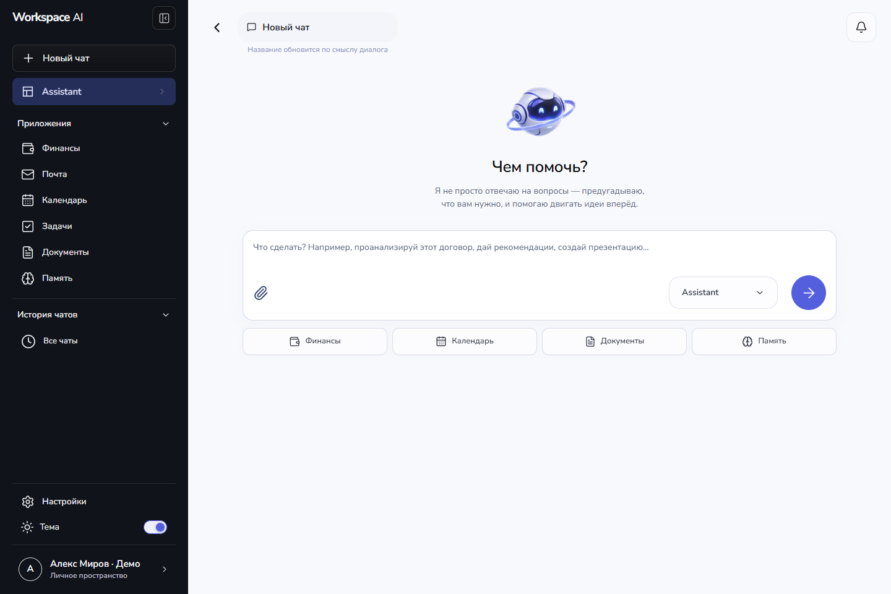
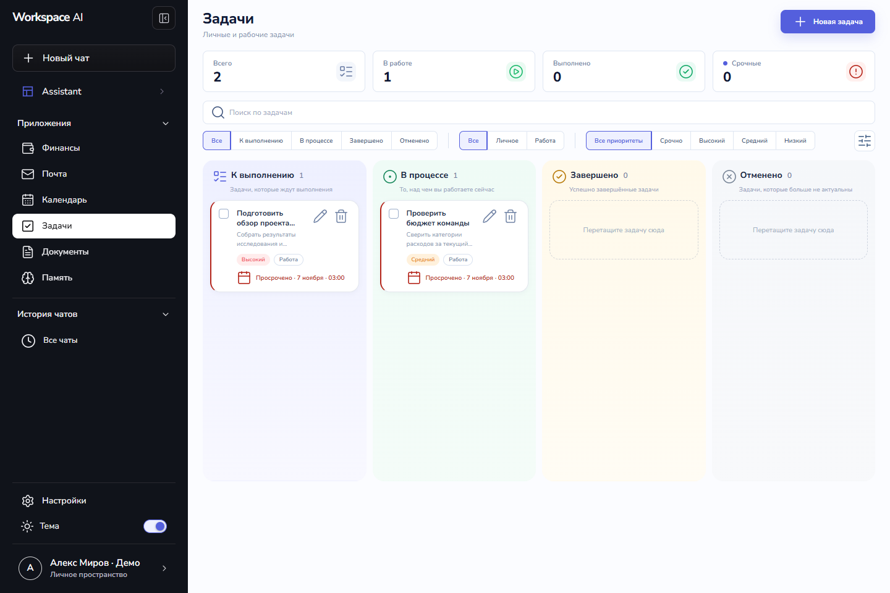
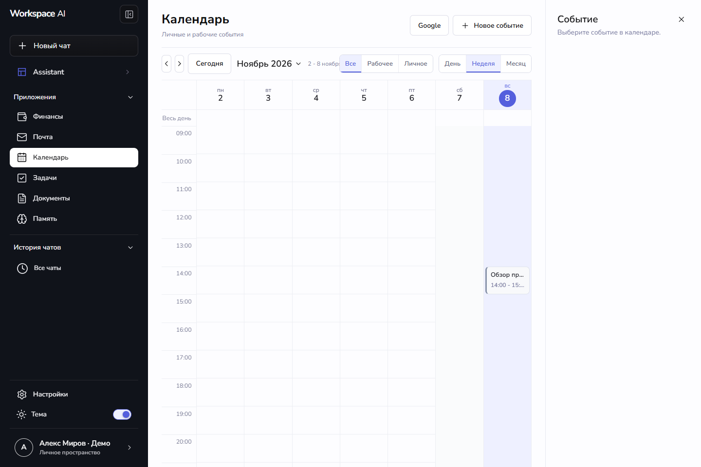
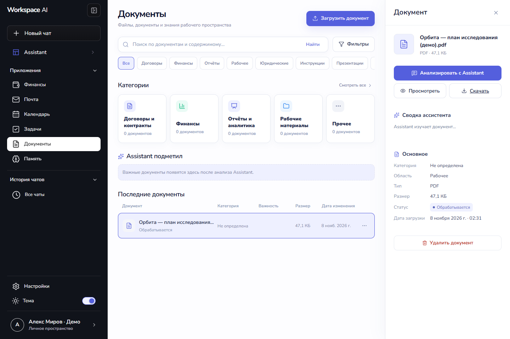
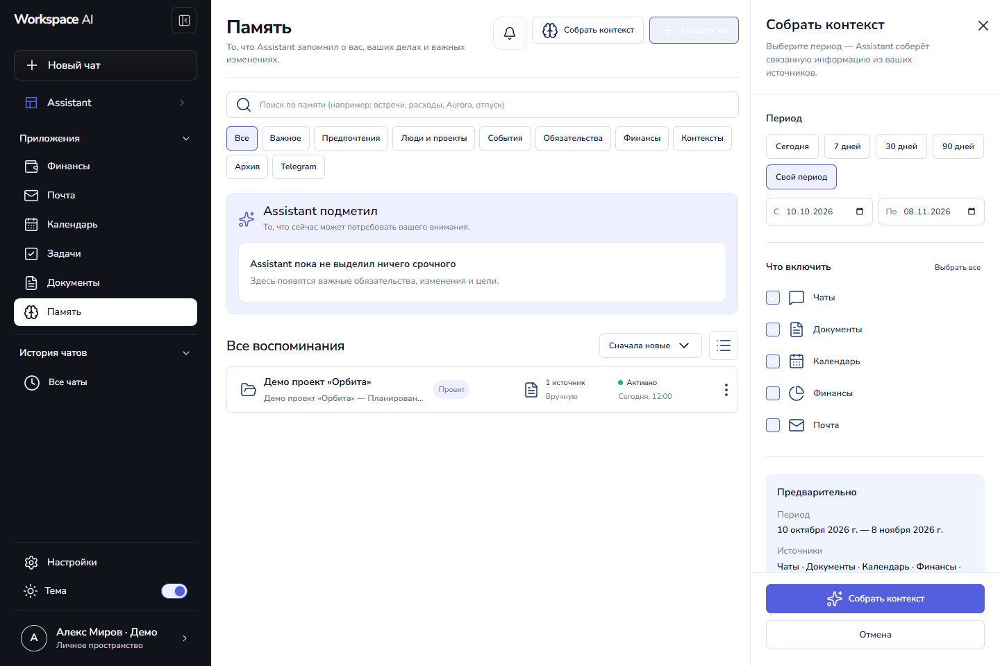
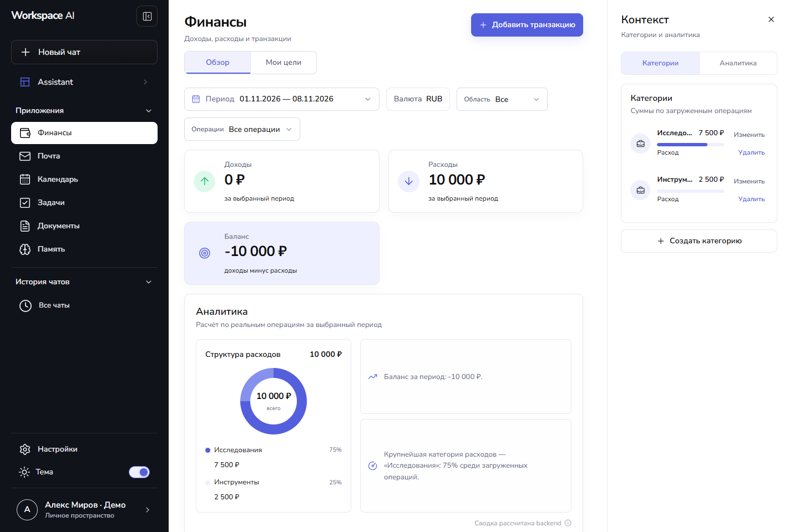
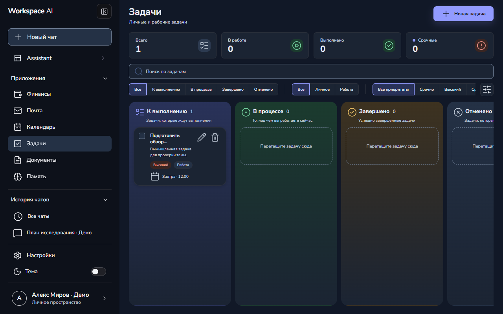
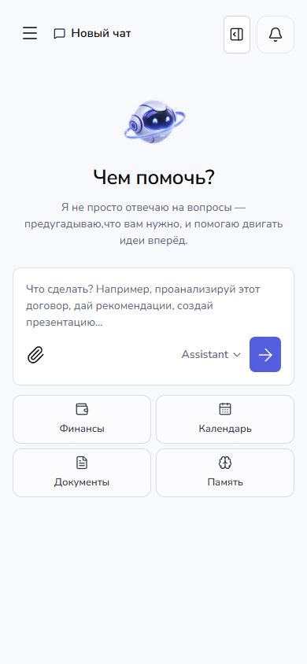

<div align="center">

# Workspace AI

### Интерфейс цифрового рабочего пространства

**Next.js · React · TypeScript · CSS Modules**

[](frontend/package.json)
[](frontend/package.json)
[](frontend/tsconfig.json)
[](frontend/eslint.config.mjs)


[Интерфейс](#интерфейс) · [Frontend-работа](#frontend-работа) · [Запуск](#локальный-запуск) · [Проверки](#проверки)

</div>



Учебный проект, созданный в рамках хакатона. Этот репозиторий представляет **frontend-часть**: вёрстку, компоненты, работу с API и качество клиентского кода. Разработка серверной части и AI-моделей в описанный frontend-вклад не входит.

> **Мобильная версия находится в разработке.** Основные сценарии адаптированы и покрыты проверками, но доработка интерфейса и проверка на реальных устройствах продолжаются.

## Интерфейс

Единое рабочее пространство объединяет чат, задачи, календарь, финансы, документы и память. Общая навигация, светлая и тёмная темы, формы и панели сведений связывают экраны в последовательный интерфейс.

| Задачи | Календарь |
|:---:|:---:|
|  |  |

| Документы | Память |
|:---:|:---:|
|  |  |

| Финансы | Тёмная тема |
|:---:|:---:|
|  |  |

<details>
<summary><strong>Мобильный интерфейс — в разработке</strong></summary>

<p align="center">
  
</p>

Компактная навигация, дневной вид календаря, вертикальная доска задач и панели документов адаптируются к доступному месту. Продолжается проверка на физических устройствах и с экранной клавиатурой.

</details>

Все изображения — реальные снимки интерфейса с вымышленными демонстрационными данными. Они не подтверждают работу внешних сервисов.

## Frontend-работа

### Вёрстка и компоненты

- Многоэкранный интерфейс на React и Next.js App Router: навигация, чат, история, календарь, задачи, финансы, документы, память и настройки.
- CSS Grid и Flexbox, ограничение длинного контента, прокрутка таблиц и code blocks, адаптация панелей и форм.
- CSS Modules для изоляции стилей и общие токены цветов, отступов и состояний.
- Светлая, тёмная и системная темы; сохранение выбора и синхронизация между вкладками.
- Типографика Nunito Sans / Science Gothic, иконки Lucide и анимации motion.
- Клавиатурная навигация, видимый фокус, закрытие диалогов по Escape и восстановление фокуса.

### TypeScript без `any`

В собственных `src/**/*.ts(x)` — **0 explicit `any`**. Включены `strict`, `noImplicitAny`, `strictNullChecks` и `useUnknownInCatchVariables`. ESLint запрещает explicit `any` и проверяет unsafe assignment/call/member access/return, а также необработанные Promise.

Внешние данные принимаются как `unknown` и проверяются runtime guards. Для доменных данных используются точные типы, nullable-поля и discriminated unions; исключения не маскируются приведением `as any`.

### Работа с API

Клиентские модули отделяют запросы и проверку ответов от экранов. Next route handlers проксируют запросы к существующему backend, сохраняя серверную работу с сессией. На стороне интерфейса реализованы состояния загрузки, пустых данных, ошибок и подтверждения действий.

Типизируются HTTP-ответы, события WebSocket, параметры форм и данные browser storage. Предлагаемые действия в чате требуют явного подтверждения пользователя. Backend и внешние провайдеры подключаются отдельно.

### БЭМ и CSS Modules

БЭМ применяется в проектных компонентах там, где помогает выразить структуру и состояния. Например, строка истории чатов использует блок `history-chat-row`, элемент `history-chat-row__selection` и модификатор `history-chat-row--selected` внутри CSS Module.

Это постепенное применение методологии: полной миграции всех CSS-классов на БЭМ не заявляется.

## Стек

| Область | Инструменты |
|---|---|
| Интерфейс | Next.js 16, React 19, TypeScript 6 |
| Стили | CSS Modules, CSS custom properties, Grid, Flexbox, БЭМ в отдельных компонентах |
| Интерактивность | React hooks, Lucide React, motion |
| Данные | HTTP API, Next route handlers, WebSocket, runtime guards |
| Качество | ESLint с type-aware правилами, Playwright, Node test runner |

## Структура

```text
frontend/
├── src/app/           # Страницы, layout и API-прокси
├── src/components/    # Экраны, навигация и общие элементы
├── src/features/      # История, календарь и документы
├── src/lib/           # API-клиенты, типы и валидация
├── tests/             # Unit, boundary и браузерные проверки
└── public/            # Ресурсы интерфейса
docs/
└── assets/            # Скриншоты для README
```

## Локальный запуск

Нужны Node.js 24 LTS и npm.

```sh
cd frontend
npm ci --ignore-scripts
npm run demo:portfolio
```

Откройте **http://127.0.0.1:3210/login**. Для демонстрации подойдут вымышленный адрес `demo@example.test` и вымышленный пароль от восьми символов. Порты 3210 и 3211 должны быть свободны.

Демонстрация использует локальные fixtures без настоящей AI-генерации и внешних записей. Она предназначена для просмотра интерфейса на своём компьютере; реальные пароли вводить не нужно.

Для работы с настоящим API создайте `frontend/.env.local` по примеру `frontend/.env.example` и выполните `npm run dev`. Серверная реализация в frontend-публикацию не входит. Ключи и токены не должны попадать в Git или `NEXT_PUBLIC_*`.

## Проверки

Результаты локальных запусков, а не статус GitHub Actions:

| Проверка | Результат |
|---|---|
| Typecheck, ESLint, полный typed lint | PASS; 0 typed lint ошибок |
| Explicit `any` в собственном TypeScript | 0 |
| Unit / boundary | 25 / 56 PASS |
| Playwright: функциональные сценарии | 84 PASS |
| Playwright: точность интерфейса | 36 PASS |
| Темы | 160 PASS; заключительная проверка страниц 8 PASS |
| Мобильный набор | 268 PASS, 20 предусмотренных desktop SKIP; заключительный повтор 48 PASS |
| Production build | PASS |

```sh
npm run typecheck
npm run lint
npm run lint:types
npm run test:boundaries
npm run test:portfolio
npm run test:precision
npm run build
```

Браузерные наборы используют установленный Google Chrome и запускаются последовательно. Матрица охватывает обе темы, ширины 320–1920 px и отдельный landscape-сценарий. Проверки с fixtures не заменяют тестирование реальных интеграций или полную WCAG-сертификацию.

Подробности: [архитектура](docs/architecture.md) · [проверки](docs/testing.md) · [происхождение и ограничения](docs/credits.md).
